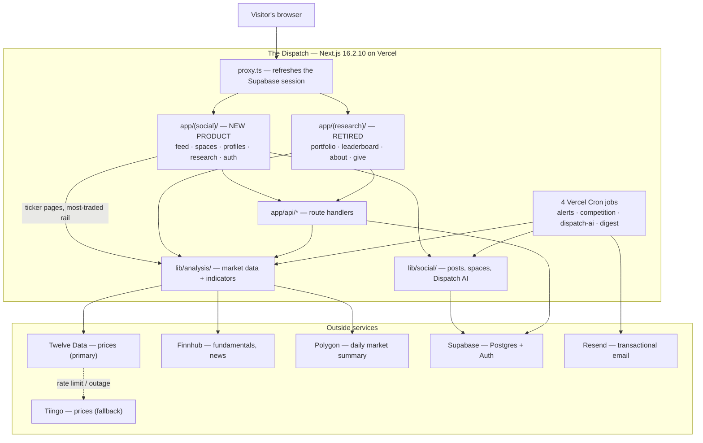

# Architecture

_A plain-language explanation of how The Dispatch works — no engineering background required._

_Last rewritten September 2026, audited against the code rather than against the planning docs.
The previous version of this file described only the retired product and is superseded._

## There are two products in this one codebase

That is the first thing to understand, and almost everything else follows from it.

**The new product — The Dispatch.** A campus-verified place where college students talk about
markets. Sign in with a school email, get a badge showing your school and class year, write
posts, work privately in a club Space, and publish the good parts to a public feed. This is
what is being built. It lives on the `feat/social-v1` branch and is served at
**try.dispatchresearch.com**.

**The retired product — the research desk.** The original site: type a stock ticker, get an
auto-generated memo with a scorecard and a buy/sell rating, plus paper trading and a monthly
leaderboard. It is being retired. It still serves **dispatchresearch.com** from the `master`
branch, untouched.

Both sets of code sit in the same repository, in separate folders, and **they do not talk to
each other.** They share exactly one thing: the login system. Everything else is separate, which
is why work on one cannot break the other.

> **A note on language.** The retired product produced *scores and ratings*. The new product
> deliberately has none — no score, no rating, no track record, no buy/sell badge, anywhere.
> If you find that language describing current behaviour, it is a leftover, not a feature.
> See `docs/product-spec.md`.

## What the new product does

1. **You sign in with a school email.** A code arrives by email (eight digits, not six). Your
   account carries a badge — school and class year, e.g. `UNH '27` — shown beside your name
   everywhere.
2. **You write posts.** A post can be a take, a question, a thesis, or a link. If you mention a
   stock like `$AAPL`, the market data for that company is attached to the post and **frozen at
   that moment**, so the post still makes sense a year later.
3. **You work privately in Spaces.** A Space is a private room for a finance club, joined by an
   invite link. What is said in a Space stays in the Space.
4. **You publish outward.** The author of a Space post can publish it to the public feed. It
   copies rather than moves, and replies stay behind in the private room. This passage between
   private and public is the actual product.
5. **Your profile accumulates.** Everything you have published publicly, at a shareable address
   (`/@yourhandle`), readable by someone without an account — which is the point.
6. **Research sits underneath the conversation.** A ticker page shows the numbers and every post
   about that company. It is a utility supporting the argument, not the reason to visit.
7. **Dispatch AI posts once a day.** A system account that writes a short, templated post from
   real site data, so the feed is not empty. Its posts are marked as generated, cannot be pushed
   back on, and are excluded from ticker counts so it cannot report on itself.

## The pieces working together

**1. The website itself** — what you see and click. Hosted by Vercel, which keeps the site
running and reachable at its domains (think of Vercel as the landlord).

**2. Supabase** — the filing cabinet. It holds every account, post, reply, Space and profile, and
it is also what checks your login. Every user's drawer is locked: the database itself enforces
that you can only read what you are allowed to read, so one user can never see another's private
Space even if the website code asked it to.

**3. Outside data companies** — the app knows nothing about markets on its own:
- **Twelve Data** — stock prices, current and historical. If it is slow or over its limit, the
  app quietly asks **Tiingo** instead, so a price still appears.
- **Finnhub** — company financials, analyst opinions, and news.
- **Polygon** — one request a day returning every US stock's trading volume for the last
  completed session, which is what fills the "Most traded" panel in the sidebar.

**4. Resend** — sends the email: sign-in codes, reply notifications, and the weekly digest.

### The constraint that shapes everything

**Twelve Data's free plan allows eight requests per minute.** A busy feed would blow through that
instantly. This is why market data is frozen onto a post when it is published rather than fetched
when someone reads it — **rendering the feed makes zero calls to any data provider.** Any new
feature that looks up many symbols at once has to be budgeted against that ceiling deliberately.
The "Most traded" panel is the model to copy: one request per day covers the whole panel.

## The jobs that run on their own

Four scheduled jobs run overnight without anyone visiting the site:

| When | What it does |
|---|---|
| 9:30pm daily | Checks every ticker on anyone's watchlist for a meaningful change and logs it (retired product) |
| 10:00pm daily | Scores the monthly leaderboard competition (retired product) |
| 10:30pm daily | Dispatch AI writes one post |
| 11:00pm Sundays | Sends the weekly digest email |

Each one is protected by a shared secret, so a stranger who finds the URL cannot trigger it.

## Keeping things safe

- **Nobody can see the secret keys.** The passwords for Twelve Data, Tiingo, Finnhub, Polygon and
  Supabase live only on the server and are never sent to a browser.
- **Your data is yours alone.** Enforced by the database itself (Postgres Row Level Security),
  not by the website's code remembering to check — so a bug in a page cannot leak someone's
  private Space.
- **Prices are never trusted from the browser.** A paper trade sends only the ticker, the side and
  the number of shares; the price is looked up on the server, so a tampered request cannot invent
  its own price.
- **Some rules are enforced in the database, not just the app.** For example, pushback on a
  Dispatch AI post is blocked by the database itself, so it cannot be bypassed.

## Known dead code, left on purpose

Recorded here so nobody assumes it is live and so nobody deletes it by surprise. All three are
verified unreachable — nothing imports them, only comments mention them.

- **`components/research/`** (7 files) — the retired product's memo interface. Documented as
  intentionally-left in `docs/phase-five-recap.md`.
- **`components/home/TickerTape.tsx`** and **`app/api/tape/route.ts`** — the scrolling ticker
  strip. Turned off deliberately ("useless for right now"); the code stays so switching it back
  on is a one-line change.

---

<details>
<summary><strong>Technical appendix</strong> (for engineers, or a future AI working on this code)</summary>

**Read `CLAUDE.md` first** — it carries the rules, the boundaries, and the traps. This appendix
is the map, not the rulebook.



### Tech stack

| Layer | Technology |
|---|---|
| Framework | Next.js **16.2.10** (App Router, Turbopack) + React 19.2.4 |
| Language | TypeScript 5, `strict: true` |
| Hosting | Vercel (auto-deploys on push) |
| Database & auth | Supabase (Postgres + Auth), `@supabase/ssr` |
| Email | Resend |
| Market data | Twelve Data (primary), Tiingo (fallback), Finnhub, Polygon |
| Tests | Vitest (unit, `lib/` only) |

Deliberately lean: **no component library, no state library, no ORM, no Prettier.**

### Routes — `app/(social)/`, the new product

| Route | What it is |
|---|---|
| `(feed)/page.tsx` | The public feed. Signed out, renders `LandingScreen` (the only indexable page) |
| `login`, `signup` | Email + eight-digit code entry |
| `onboarding` | Post-auth profile setup; branches student / mentor (allowlist) / unsupported school |
| `p/[id]` | A single post and its replies |
| `u/[handle]` | Public profile. Served at `/@handle` via a rewrite in `next.config.ts` |
| `s/[slug]` | A private Space's feed (member-only, enforced by RLS) |
| `s/new`, `spaces` | Create a Space; index of your Spaces |
| `j/[token]` | Invite-link landing; resolves to one of five states, renders `InviteModal` |
| `research`, `research/[ticker]` | Ticker search and ticker pages — numbers above, conversation below |
| `disclaimer`, `guidelines` | Legal text (noindex) |
| `layout.tsx` | Fetches profile + Spaces server-side; renders header, nav, most-traded rail, footer |

### Routes — `app/(research)/`, the retired product

`about`, `give` (charity, no paid tier), `portfolio` (paper trading), `leaderboard` and
`leaderboard/[month]`. Its `layout.tsx` mounts the portfolio and competition providers and
modals, scoped to this surface only. `/leaderboard` is not linked anywhere and was removed from
`sitemap.ts`; it is reachable only by typing the URL.

### API routes — `app/api/`

| Route | Method | Purpose |
|---|---|---|
| `analyze/[ticker]` | GET | Full price/fundamentals/news bundle (retired product's core endpoint) |
| `fundamentals-change/[ticker]` | GET | Time Machine "how the business changed" figures |
| `composer/ticker/[symbol]` | GET | Debounced ticker snapshot for the post composer |
| `auth/request-code` | POST | Rate-limited (email + IP), school-domain-gated code request |
| `replies` | POST | Reply/pushback insert + best-effort email notification |
| `watchlist` | GET/POST/DELETE | Watchlist CRUD, max 8 |
| `alerts` | GET | The signed-in user's recent alert events |
| `notifications/unsubscribe` | GET | Token-based one-click unsubscribe (returns plain HTML) |
| `portfolio/account` · `portfolio/trade` · `portfolio/equity-curve` | — | Paper trading |
| `competition/profile` · `competition/account` · `competition/trade` · `competition/snapshot` | — | Monthly leaderboard |
| `cron/alerts` · `cron/digest` · `cron/dispatch-ai` | GET | Scheduled jobs, `CRON_SECRET`-gated |
| `tape` | GET | **Unused** — backed the disabled ticker tape |
| `app/auth/callback/route.ts` | GET | Exchanges an auth code for a session |

### `lib/`

| Path | Holds |
|---|---|
| `lib/analysis/` | Market data and indicators. `loadReport.ts` (shared fetch/build, exports `TICKER_PATTERN`), `indicators.ts`, `scoring.ts`, `report.ts`, `historical.ts`, `compare.ts`, `fundamentalsChange.ts`, `alertState.ts`, `markdown.ts`. Newer and lighter, built to dodge the Twelve Data ceiling: `tickerSnapshot.ts`, `tickerChart.ts` (Finnhub-only), `mostTraded.ts` (Polygon) |
| `lib/social/` | `queries.ts` (row→type mapping for posts/replies/profiles), `spaces.ts`, `dispatchAi.ts` (the generated-post templates), `cashtags.tsx`, `handle.ts`, `badge.ts`, `avatar.ts`, `schoolDomain.ts`, `time.ts`, `resizeImage.ts`, and the client hooks (`useOptimisticFeed`, `useModalA11y`, `useTickerAttach`, `useAutoGrowTextarea`) |
| `lib/competition/` | Monthly leaderboard: `rules.ts`, `scoring.ts`, `trading.ts`, `publicBoard.ts`, `marketHours.ts` |
| `lib/supabase/` | `client.ts` (browser), `server.ts` (request-scoped), `service.ts` (**service-role — server only, never reachable from a client component**), `proxy.ts` |
| `lib/email/` | `resend.ts` (send wrapper), `templates.ts` (HTML, escaping, unsubscribe links) |
| Root | `providers.ts` (Twelve Data/Tiingo/Finnhub wrappers + `unstable_cache`), `portfolio.ts`, `cache.ts`, `db.ts`, `useTheme.ts` |

### `components/`

| Path | Holds | Status |
|---|---|---|
| `social/` | ~40 files: composer, post cards, replies, Spaces, identity badges, chrome, ticker UI | Live — the new product |
| `auth/` | `AuthProvider`, `AuthModal`, `AccountModal` | Live — **the only thing both products share** |
| `layout/` | `Masthead`, `TopNav`, `Footer`, `Logo`, `ThemeToggle`, `AlertBell` | Retired surface, except `Logo`/`ThemeToggle` which social reuses |
| `portfolio/`, `competition/`, `leaderboard/`, `trade/` | Paper trading and the monthly leaderboard | Live on the retired surface |
| `research/` | The old scored-memo UI | **Dead** — no importers |
| `home/` | `TickerTape.tsx` | **Dead** — no importers |

### Database migrations

Hand-run SQL, pasted into the Supabase SQL editor by Eli — this is not a Supabase CLI project
(no `config.toml`, no `seed.sql`). **Never execute DDL against the live database.**

| File | What it adds |
|---|---|
| `0001_subscriptions` | `subscriptions` (the removed paid tier) |
| `0002_alerts` | `ticker_snapshot`, `alert_event` |
| `0003_leaderboard` | Competition profile, accounts, positions, trades, public views |
| `0004_leaderboard_price_cache` | `competition_price_cache` |
| **`0005`** | **Missing — no file, no note on disk. Numbering jumps 0004 → 0006.** |
| `0006_social` | `schools`, `profiles`, `posts`, `replies`, core RLS |
| `0007_composer` | Post `type`, `ticker`, `ticker_snapshot`, `position`, `change_my_mind`, `link_url` |
| `0008_pushback_notifications` | `is_pushback` (80-char min), notification prefs, unsubscribe token |
| `0009_school_colors` | School accent colours |
| `0010_avatars` | `avatar_url` + Storage bucket policies |
| `0011_spaces` | `spaces`, `space_members`, promotion columns, first `security definer` helpers |
| `0012_fix_space_rls_recursion` | Fixes a real infinite-recursion RLS bug |
| `0013_profile_linkedin` | `linkedin_url` |
| `0014_roles` | `role` (student/faculty/mentor), `affiliation`, `mentor_allowlist` |
| `0015_display_name_cooldown` | 14-day display-name change cooldown trigger |
| `0016_dispatch_ai` | `system` role for the Dispatch AI account |
| `0017_fix_dispatchai_handle_reserved` | Fixes reserved-handle blocking its own account |
| `0018_generated_ticker_no_position` | Relaxes a constraint for generated posts |
| `0019_no_pushback_on_generated` | Database-level trigger blocking pushback on generated posts |
| `0020_invite_preview` | Widens `get_space_by_invite_token` for the invite modal |

### Environment variables

Set in `.env.local` and in Vercel production. Values are secrets — never commit them, never paste
them into a conversation.

```
NEXT_PUBLIC_SUPABASE_URL          NEXT_PUBLIC_SUPABASE_ANON_KEY
SUPABASE_SERVICE_ROLE_KEY         NEXT_PUBLIC_SITE_URL
TWELVE_DATA_API_KEY               TIINGO_API_KEY
FINNHUB_API_KEY                   POLYGON_API_KEY
RESEND_API_KEY                    CRON_SECRET
```

`RESEND_API_KEY`'s presence in Vercel production has never been confirmed. Every signup depends
on it. See `docs/state-of-play.md`.

### Scheduled jobs (`vercel.json`)

| Schedule (UTC) | Path |
|---|---|
| `30 21 * * *` | `/api/cron/alerts` |
| `0 22 * * *` | `/api/competition/snapshot` |
| `30 22 * * *` | `/api/cron/dispatch-ai` |
| `0 23 * * 0` | `/api/cron/digest` |

All four check `Authorization: Bearer $CRON_SECRET`.

### Known duplication and rough edges

Recorded so they are not rediscovered, and because the lint rules in `eslint.config.mjs` exist to
stop them spreading:

1. **The ticker regex `/^[A-Z.\-]{1,10}$/` is re-declared inline** in `app/api/portfolio/trade`,
   `app/api/competition/trade` and `app/api/watchlist` instead of importing `TICKER_PATTERN` from
   `lib/analysis/loadReport.ts`.
2. **Buy/sell mutation logic is written twice**, near-identically, inside
   `app/api/portfolio/trade/route.ts` and `app/api/competition/trade/route.ts` — the read-side
   equivalents were correctly factored into `lib/portfolio.ts` and `lib/competition/trading.ts`,
   but the writes were not. This is the canonical example of business logic that belongs in
   `lib/`.
3. **Two same-named `HANDLE_PATTERN` / `RESERVED_HANDLES` validators** — one in
   `lib/social/handle.ts` (social identity), one inline in `app/api/competition/profile/route.ts`
   (competition identity). Intentionally separate systems, but the identical naming is a real
   drift risk, and there is no shared uniqueness constraint between the two handle spaces.
4. **`lib/competition/trading.ts` mirrors `lib/portfolio.ts`** almost field for field. A
   deliberate call ("same math, genuinely different tables"), documented in its own header.
5. **Comments cite planning documents that do not exist**: `dispatch-backend-architecture.md`
   (in `app/api/analyze/[ticker]/NOTES.md` and `lib/cache.ts`), `claude/leaderboard-plan.md` and
   `dispatchleaderboardprompt.md` (in `lib/competition/`), `dispatch-alerts-plan.md` (in
   `0002_alerts.sql`).
6. **No test coverage under `app/` or `components/`.** Vitest covers pure functions in
   `lib/analysis/` and `lib/competition/` only.

</details>
